# 1. Method and limits

**Builds compared.**

* **Before:** `v3.7.0`, the owner upload (`dist-v370`).
* **After:** v3.8 final (`dist-rc1`, commit recorded in each image's JSON).
* **Intermediate:** discovery builds (`v380` = b1798c9, `wip6–wip12`). These are shown where they document a regression or a
  fix.

**How the images were made.**

* The harness is `tools/qa/scenarios/golden38.mjs`, with views from `views37.mjs` and `views38.mjs`.
* Each view sets the same epoch (2026-10-08 12:00 UTC), the same body-frame camera geometry, field of view, mode and quality.
  It settles exposure over at least 6 frames and saves a PNG plus a JSON sidecar.
* The sidecar records version and commit, body, UTC and TT, camera position and quaternion, distance and altitude, field of
  view, phase angle, exposure EV, sky EV, viewing mode, quality, tone map, detail tier, enhancement labels and gains, the
  atmosphere source, the renderer adapter, the meter debug and known limitations.

**Renderer.** Chromium 154 with **SwiftShader (software) WebGPU**. Small-body compute was disabled, because it loses the device
on SwiftShader (GPU-003).

**What these images do and do not show.** They show *what is computed*: geometry, exposure, layering and the presence or absence
of features. They do **not** show real-GPU colour, anti-aliasing, frame pacing or smoothness. Resolution is 1600 × 900; 4K was
not used because each capture takes about 45 s on the software adapter.

**Build identity.** The 94-view render set was captured on commit fe0bd93. The release commit differs from it only in
`src/ui/ui.ts` and `src/ui/styles.css`: UI targets, the hover card and label placement. The renderer is identical. The UI,
loader, journey and Galactic sets were captured on the release build.

**Where the files are.** Every original image is in `QA_IMAGES/` in the evidence package, under the names used here.

# 2. Sun

**Findings.**

* **Before:** the Sun disappeared beyond about 1 ly (DEF-38-002), and the point stayed on the scene exposure.
* **After:**
  * There is a continuous cross-fade on angular size. In the ordered 0.3 → 3,000 AU sequence, no popping is visible between
    frames.
  * The glare rises and falls monotonically.
  * The Sun at 1 pc and at Proxima's distance is a compressed point, comparable to the brightest stars.
* **Consistency across modes:** Scientific uses one exposure; Exploration and Cinematic decouple the sky (labelled).

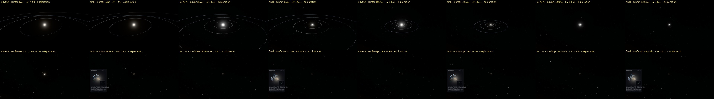

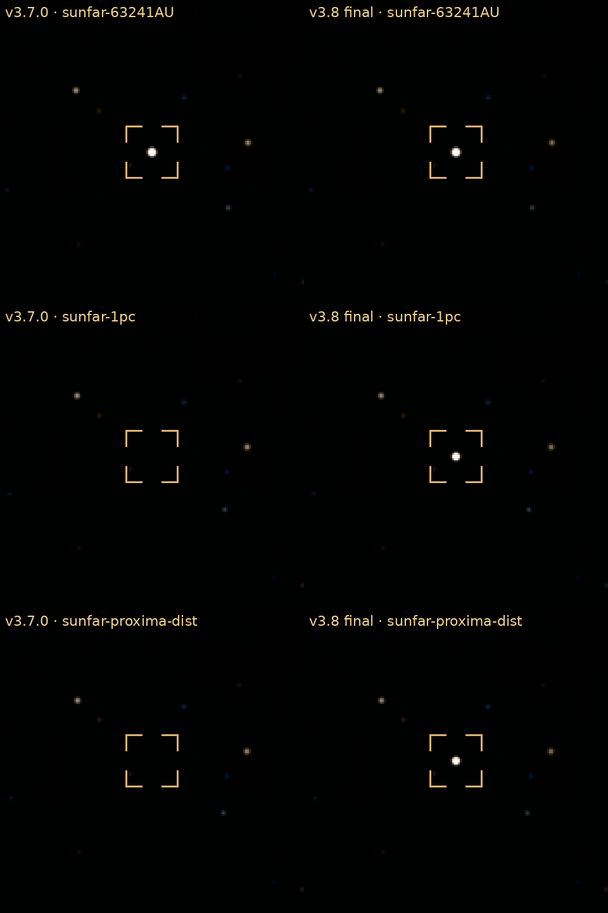

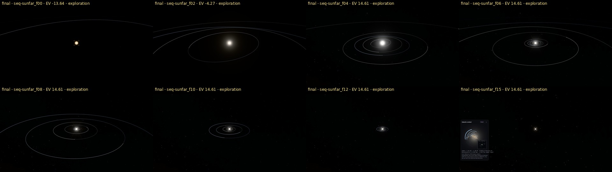

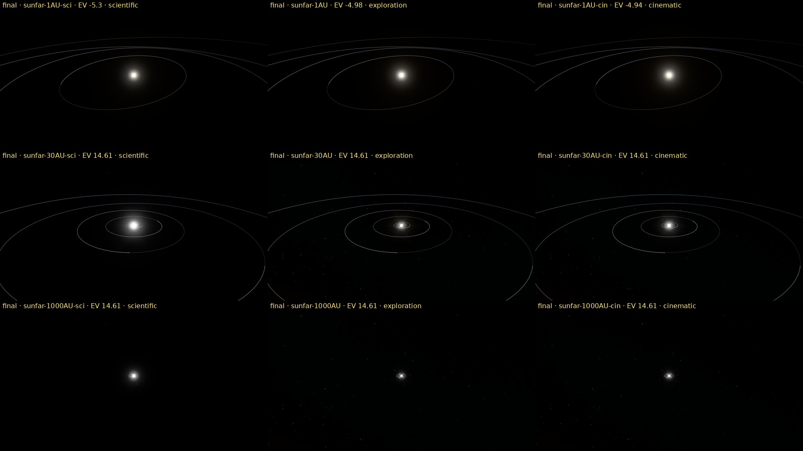

# 3. Lighting, exposure and atmospheres

**Findings.**

* The Venus terminator went from −9.25 to −1.32 EV, and the cloud-top flight is now −1.29 EV.
* The backlit Venus limb ring is restored after the DEF-38-001 regression.
* **Not improved:** the cloud deck is still a static map (no volumetric clouds).

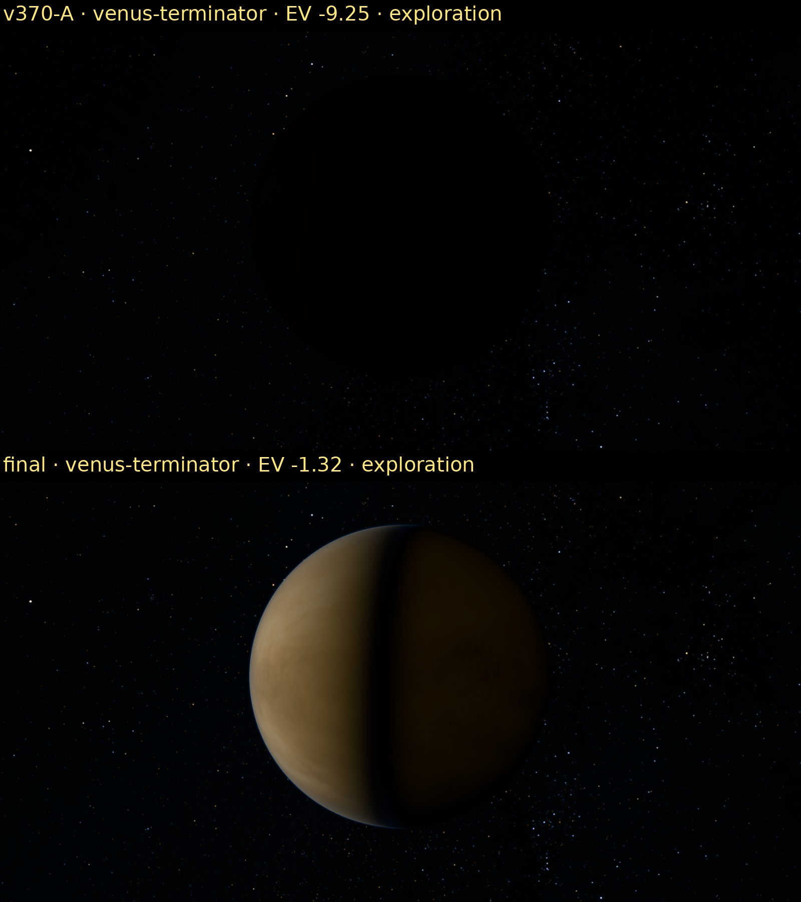

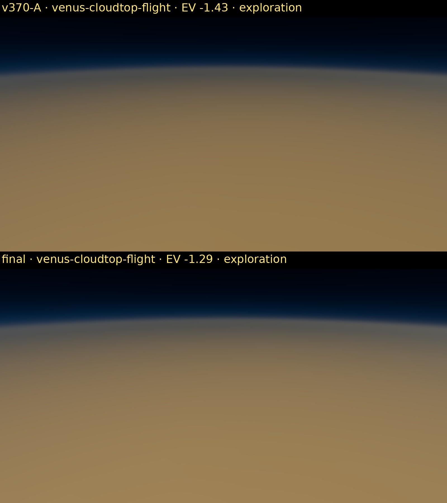

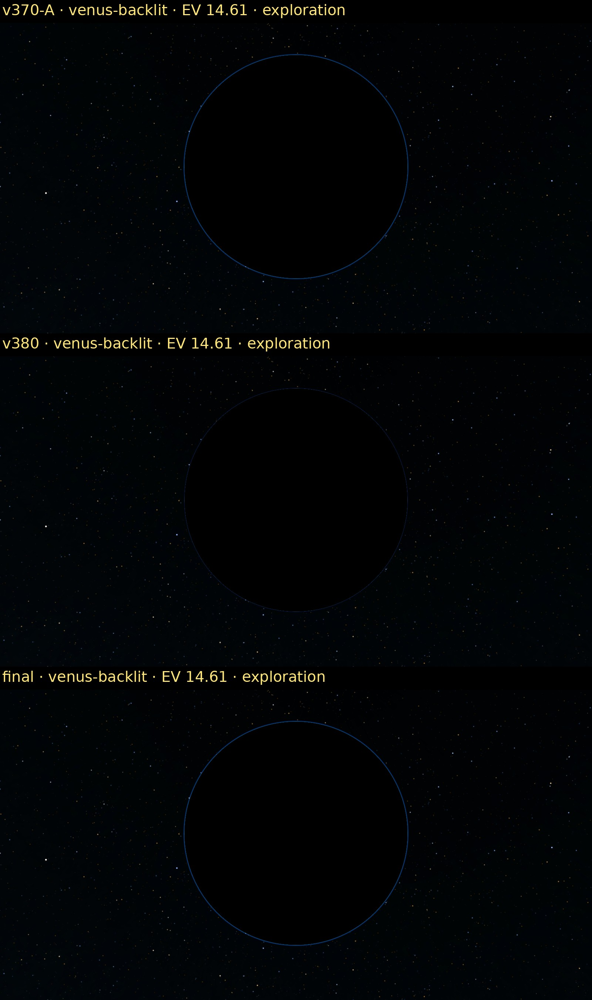

# 4. Rings

**Findings.**

* Jupiter's backlit rings no longer clip; the gain is labelled.
* Uranus' ε ring shows its eccentric width, although the precession sequence is subtle at system scale.
* Pan now sits in the Encke gap.
* The streaks near Prometheus are the real concentric ringlets, seen from 15 km below the plane.

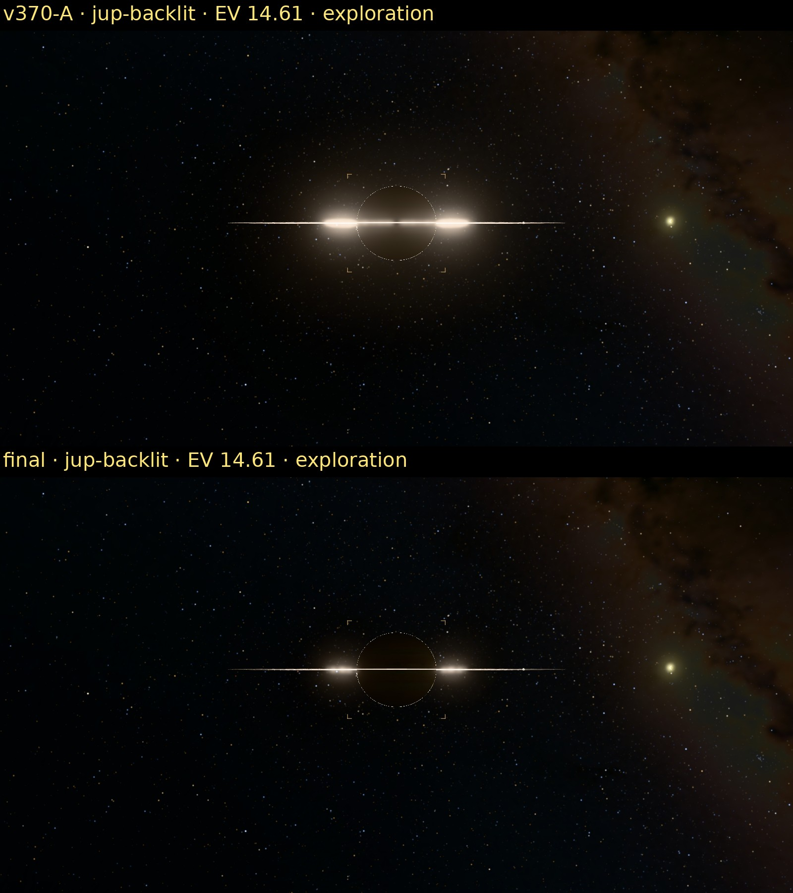

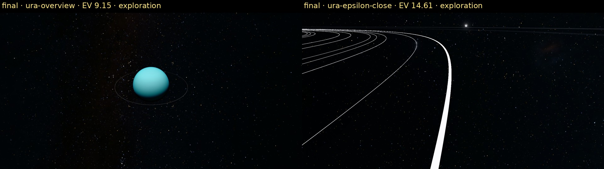

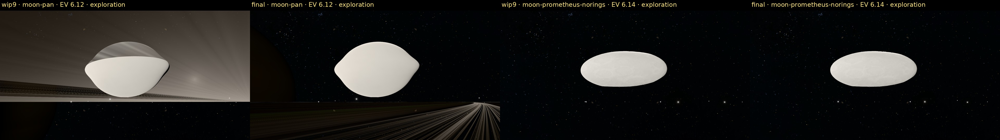

# 5. Plumes

**Findings.**

* Pele and Tvashtar are clearly visible on the sunlit limb, both labelled-enhanced and physical.
* Enceladus is unclipped.
* **Still REPRESENTATIVE:** the canopies still look slightly granular at close range, and the plume activity is not dated
  (no time variation).

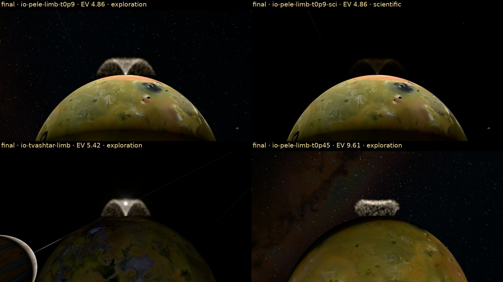

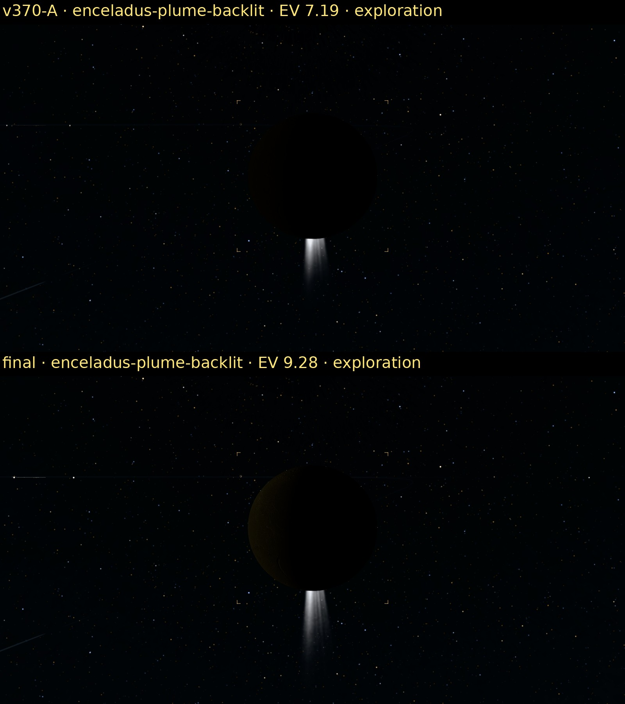

# 6. Moons and small bodies

**Findings.**

* 100 km moons no longer have planar limbs, and dark irregulars no longer share one blotch pattern.
* Sycorax and Kiviuq are now resolved at their estimated sizes.
* **Still poor:**
  * Saturn's bright ring moons render as nearly featureless white bodies.
  * The procedural crater patterns on large dark moons are plausible but generic.
  * The Phoebe shape is observed, but its surface albedo pattern is not.

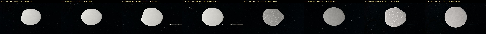

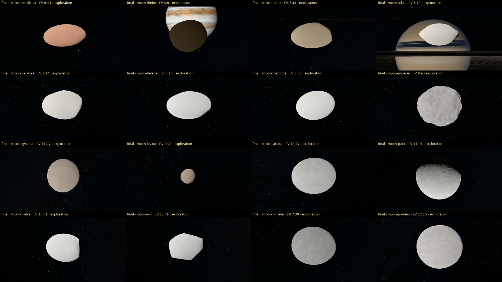

# 7. Stars, the Milky Way and the Proxima journey

**Findings.**

* **Streaming:** shards stream in flight.
* **Sun from Proxima:** a point, labelled.
* **Red dwarfs:** their brightness is now V-band (DEF-38-013).
* **Galactic context card:** shown beyond 2,000 AU, labelled Model.
* **Background:** the sky is still the observed 2-D Gaia panorama. There is no 3-D Galaxy rendering.

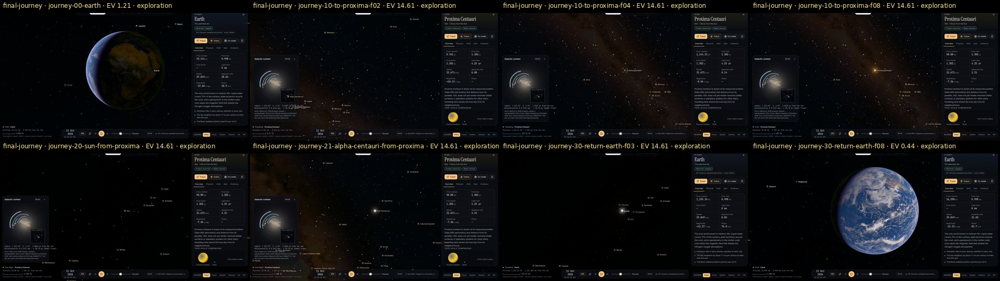

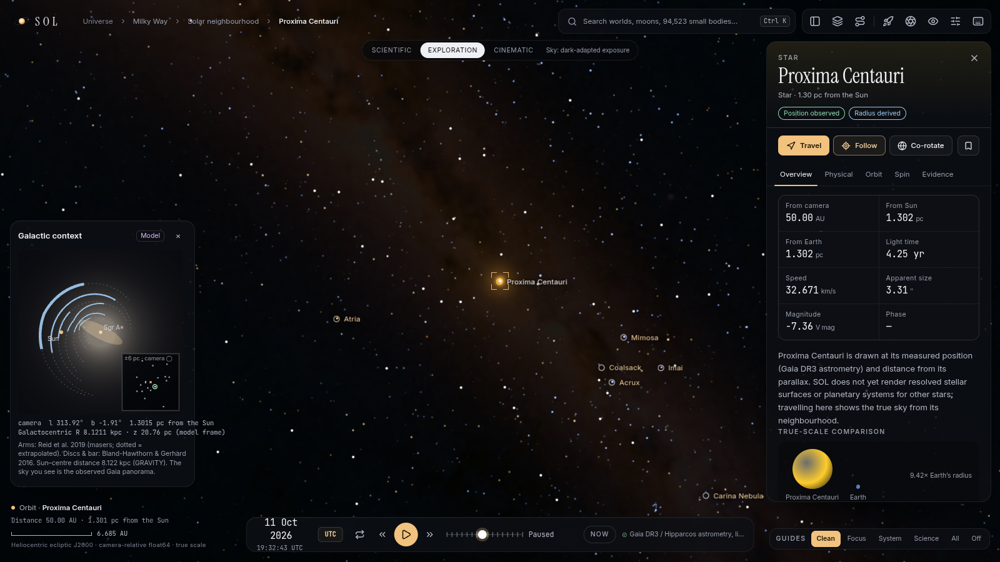

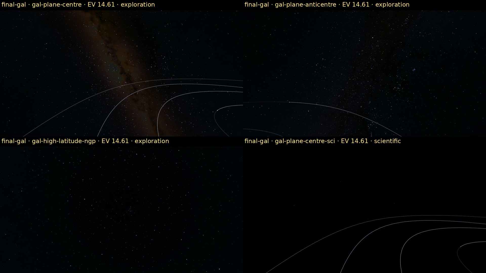

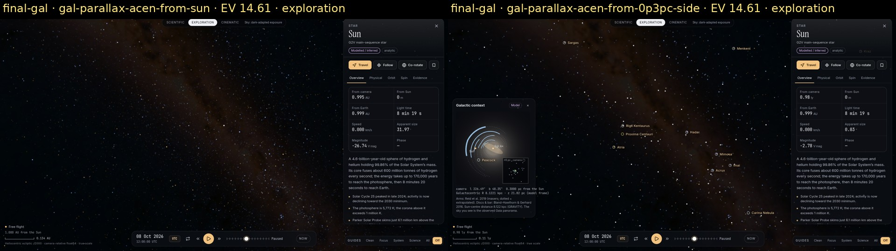

# 8. UI/UX and loading

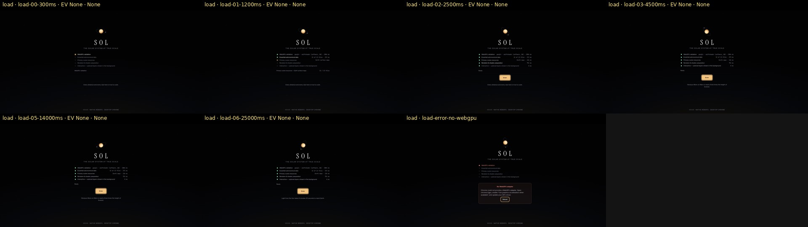

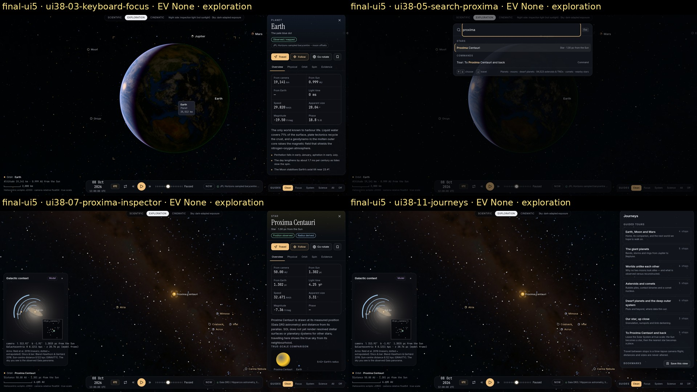

# 9. Terrain

There was no terrain work in v3.8, and the v3.6/v3.7 Hadley and Jezero descents were not re-captured. Regression risk is low,
because the terrain code is unchanged. The shared metering change (DEF-38-003) does apply near the surface, however, so a
hardware re-check of the near-surface exposure is listed as UNVERIFIED.

# 10. Index of failures and residual visual problems

| Area | Residual | Severity |
|---|---|---|
| Saturn ring moons | featureless white under auto-exposure; no controlled mosaics | High (owner priority §14) |
| Small-moon surfaces | generic procedural craters | Medium |
| Io canopies | slightly granular close up | Low |
| Sun | real-GPU bloom/glare look unverified | Medium |
| Galaxy | 2-D panorama only (by design in v3.8) | Known scope |
| Terrain | not re-captured | Low |
