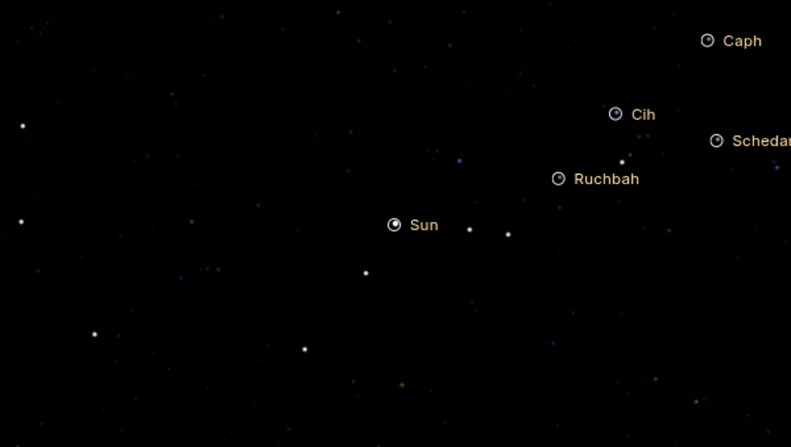

# 1. Summary

* **Release.** `sol-solar-system-v3.8-final.zip` (one consolidated application). Git tag `v3.8.0` on master; the release commit
  is in `docs/RELEASE.md`.
* **Starting source.**
  * Tag `v3.7.0`: the owner's upload, unchanged.
  * Branch `v3.7.1`: corrective-only history, retained.
  * Master: v3.7.1 corrections plus v3.8, 24+ commits.
* **Where it was verified.** Chromium 154 with SwiftShader, i.e. software WebGPU. This is enough to show functionality,
  correctness and relative performance on the same machine. It is **not** evidence of real-GPU look, frame rate or smoothness,
  which remain UNVERIFIED (§11).

| Workstream (spec §15) | What actually ships | Status |
|---|---|---|
| 1 Far-distance Sun | Continuous disc → point regimes on angular size; point source in the sky domain with star compression; continuous glare; point-source clipping beyond 1e13 km fixed | DONE (software) |
| 2 Lighting & exposure | Off-frame metering root cause; near-surface ray-grid coverage; plume/ring highlight metering; LUT precision fix | DONE (software); planetshine/BRDFs unchanged |
| 3 True-scale stellar neighbourhood | Gaia DR3 parallax refinement (2,534 stars < 20 pc); 9 navigable named nearby stars; radial interstellar travel; ly/pc HUD; catalogue streaming verified in flight; G→V photometry | DONE (foundation) |
| 4 Milky Way foundation | Parametric model (Reid 2019 arms, BHG16 discs/bar, Drimmel–Spergel dust), Galactic context card, ICRS↔Galactic↔Galactocentric frames, 9 deep-sky reference objects | PARTIAL by design: model + metadata; the sky is still the observed 2-D Gaia panorama (labelled) |
| 5 Moon/asteroid individuality | Measured properties; size-dependent geology; PDS shapes for Itokawa and Phoebe; JPL/MPC sizes for 414 moons; J2 orbit fix | PARTIAL (no new controlled mosaics) |
| 6 UI/UX | Truthful staged loader; Galactic card; stellar journey tour; search ranking fix; star inspector (V-band, Teff colour); a11y fixes (Tab trap, contrast, target size, stale hover) | PARTIAL: polish, not a redesign |
| 7 Travel performance | Profiled; Saturn 12.2 s freeze removed; LUTs and shapes in workers; predictive preparation; long tasks 18.1 s → 3.4 s on the scripted route | DONE (software CPU); real-GPU UNVERIFIED |
| 8 Integration | Single release, all v3.7.1 fixes present (verified hunk by hunk) | DONE |
| 9 QA | 94-view final capture set + journey + UI + loader + perf, with metadata | DONE (software) |
| 10 v3.9/v4.0 readiness | Frames, catalogue streaming, Galactic model in place; roadmap in the hand-off | DOC |

# 2. Implementation history (commits, oldest first)

| Commit | Change |
|---|---|
| 93f682c / 3e57a91 / bc0e113 | v3.7.1 corrections (see the v3.7 report) + far-Sun regimes, plume physics, minor-moon identity |
| ab11385 / 4528737 | Gaia DR3 parallax refinement, nearby navigable stars, radial interstellar travel, ly/pc HUD |
| 3d34ef8 | Milky Way structural model, Galactic context card (M), deep-sky reference objects |
| 7627f14 | PERF-005 LUT worker; PERF-007 predictive view preparation + warm frames; truthful staged loader; travel38 profile |
| 3177434 | PERF-009 family-shape generation in a worker; journey38 scenario |
| 1f07be8 | Stellar journey tour |
| e7bbdfb | Observed shape models for Itokawa and Phoebe (PDS SBN), Phoebe IAU rotation |
| b1798c9 | Version 3.8.0 + build commit in metadata (checkpoint before this session's QA) |
| f41868a … fe0bd93 | DEF-38-001 … DEF-38-013 (§9) |

# 3. Far-distance Sun (spec §16–18)

**Audit findings (v3.7.0).**

1. **Under-bright point.** Below a few pixels the Sun became a point source, but it stayed on the **scene** exposure,
   uncompressed. Stars and unresolved planets use the sky exposure (+3.6 EV in Exploration) with highlight compression. Beyond
   about 10⁴ AU the Sun was therefore drawn fainter than first-magnitude stars, although it is m = −2.7 at 1 ly and −0.17 at 1 pc.
2. **Glare plateau.** Glare was hard-capped (`min(F·0.6·LS, 3)`): an identical saturated blob from 5 to 1,000 AU, then a
   collapse.
3. **Far-plane clipping (DEF-38-002).** Any body point beyond the 1e13 km far plane (about 66,800 AU) was clipped. The Sun
   **disappeared completely** beyond about 1.06 ly (v3.7.0 `sunfar-1pc` and `sunfar-proxima-dist` contain no Sun).

**Implementation.**

* **Regime blend.** The disc-to-point cross-fade conserves flux. The point's exposure glides in log space from the scene
  exposure to the sky exposure as the cross-fade completes, and it takes the same highlight compression as the stars
  (identity in Scientific mode).
* **Glare.** Continuous ∝ x^0.4 (linear in Scientific).
* **Far points.** Pinned to the reversed-depth far plane (`z = max(c.z, 0)`) and still depth-tested.

| Distance | θ = 2 atan(R☉/d) | Apparent V | SOL regime |
|---|---|---|---|
| 0.05 AU | 638′ | −33.25 | resolved photosphere |
| 1 AU | 32′ | −26.74 | resolved disc |
| 5 AU | 6.4′ | −23.25 | disc → point cross-fade |
| 30 AU | 1.07′ | −19.35 | point (sky domain, compressed) |
| 1,000 AU | 1.92″ | −11.74 | point |
| 1 ly | 0.030″ | −2.74 | point |
| 1 pc | 0.0093″ | −0.17 | point |
| 1.302 pc | 0.0071″ | +0.41 | point |

# 4. Lighting and exposure (spec §19)

* **Off-frame metering (ATM-011) and near-surface coverage (DEF-38-003).** See the v3.7 report §4.1.
* **Highlight metering.**
  * Ring peaks and plume peaks enter the highlight meter, so a bright backlit plume no longer clips.
  * The plume peak sums overlapping jets (DEF-38-004).
* **LUT precision (DEF-38-001).** The worker-built LUTs now use an IEEE binary16 encoder with subnormals and
  round-half-to-even.
* **Unchanged in v3.8.**
  * Planetshine (physical, already present).
  * Surface BRDFs (Minnaert/Hapke-like per class).
  * Colour management.
  * The Milky Way does not light night sides; inspection light stays a labelled enhancement.

# 5. True-scale stellar neighbourhood (spec §21–24)

**Data (§21).**

* **Base catalogue.** 335,865 stars within 100 pc in true 3-D: GCNS (Gaia EDR3/DR3) plus Hipparcos-2, epoch J2016.0. This
  pre-existing v3.4 architecture is verified, not rebuilt.
* **Quantisation found.** GCNS distances are quantised at 0.01 pc, which put Proxima about 400 AU from its true position.
* **Refinement.** v3.8 refines **2,534 stars within 20 pc** from Gaia DR3 parallaxes (query result shipped in
  `tools/ingest/queries/gaia_dr3_parallax_gt50mas.csv`). Proxima is at 1.30197 pc.
* **Error and quality data kept.** σd/d per row, a radial-velocity flag, RUWE > 1.4 and white-dwarf flags.

**Photometric band (DEF-38-013, owner-reported 2026-10-11).**

* The rows' absolute magnitudes are **Gaia G** (Hipparcos Hp for Hipparcos-only stars), but they were used as if they were V,
  both in the renderer's flux zero point and in the HUD.
* They are now converted with the Gaia EDR3 relation G − V = −0.02704 + 0.01424 C − 0.2156 C² + 0.01426 C³ (C = BP − RP,
  σ = 0.030 mag; Riello et al. 2021, Table C.2; Gaia EDR3 documentation §5.5.1). C is recovered exactly from the ingest's own
  Teff(BP−RP) fit.
* **Check.** Proxima comes out at M_V ≈ 15.7 against SIMBAD's 15.56 (V = 11.13, ϖ = 768.07 mas). The HUD shows −7.36 V mag
  from 50 AU, where SIMBAD-based arithmetic gives −7.52: a 0.16 mag gap, within the G−V relation's scatter at extreme colour
  plus the Teff-fit inversion. Red dwarfs were previously drawn about 7× too bright.
* **Labels.** HUD magnitudes now read "V mag", and the inspector also shows the source G or Hp value.
* **Colour.** Named stars had one fixed colour; it now comes from Teff (DEF-38-011).

**Streaming (§22).**

* **Mechanism.** The `CatalogStream` contract (v3.4/3.5) manages 85 SHA-256-verified sector shards, requested nearest-first
  around the observer once the camera is more than 300 AU from the Sun. Shards are resident within 110 pc and evicted beyond
  180 pc.
* **Evidence of dynamic loading.** In the journey run, 54 shards were resident at 0.04 pc after leaving and 85 near Proxima.
  Before 300 AU the 3-D layer is not loaded at all.
* **Other properties.**
  * Proper motion: linear space motion from J2016.0.
  * Duplicate avoidance: Hipparcos rows are dropped when a Gaia match lies within 0.02 rad and Hp − G is consistent.
  * Precision: positions are camera-relative, and points are drawn on a 1e9 km sphere in the camera direction.

**Frames (§23).** `contracts/frames.ts` provides:

* ecliptic J2000 ↔ ICRS ↔ Galactic (IAU 1958 / Hipparcos rotation matrix);
* Galactocentric (Astropy v4.0 conventions: R0 = 8.122 kpc, z☉ = 20.8 pc);
* km/AU/pc/ly conversions.

Tests: Sgr A* maps to l = 359.94°, b = −0.05°, and the north Galactic pole maps to b = 90°.

**Journey (§24).**

* **Route.** Earth → Proxima Centauri → look back at the Sun and at α Cen → return to Earth, flown with the application's own
  flight system (`rig.goTo`, chosen through the search/inspector selection path).
* **Radial travel.** Interstellar legs (either end beyond 2,000 AU) are radial: along the real line of travel, with the viewing angle turning only in the last 40 % of the approach; at most 9 s (×0.35 with reduced motion). A
  flight can be cancelled with W/A/S/D, the wheel or a drag (verified in ui38: `cancelByKey → flying false`).
* **Precision.** All 21 recorded frames have finite state, the distance is monotonic along each leg, and HUD readouts agree
  with the metadata (e.g. 50.00 AU from Proxima, 1.302 pc from the Sun, light time 4.25 yr).

# 6. Milky Way foundation (spec §25–26)

**The model.** `src/galaxy/milkyWayModel.ts` is a cited, parametric, **inferred** model. It is not observed 3-D structure.

* **Arms.** Reid et al. 2019 log-spiral arms with kinks. A test reproduces the published arm tangencies (3-kpc 337.0°, Norma
  327.5°, Sct–Cen 306.1°, Sgr–Car 285.6°).
* **Discs and bar.** BHG16 thin disc 2.6 kpc / 300 pc, thick disc 2.0 kpc / 900 pc, bar 5.0 kpc at 27°.
* **Dust.** Drimmel & Spergel 2001 dust disc.
* **Sgr A\*.** Position and distance (GRAVITY 2019).

**Where it shows.**

* **Galactic context card.** Opened with M, or automatically beyond 2,000 AU. It draws the face-on schematic, the Sun's
  position, a local inset with the camera and the nearest navigable stars, and the camera's Galactic l, b and Galactocentric
  R, z.
* **Labelled "Model".** The sky itself remains the observed Gaia panorama (point sources removed), calibrated to about
  21 mag arcsec⁻² in the band.

**Deep-sky reference objects (§26).** Nine: Hyades, Pleiades, Praesepe, the Taurus Molecular Cloud, the Coalsack, M42, M8, the
Carina Nebula and Sgr A*.

* Each has an ICRS centre and a distance with its source, plus an evidence class.
* They are marker-only (not rendered as volumes), with a navigability guard: they are not flyable beyond the 100 pc catalogue.

# 7. Visual identity and assets (spec §27–31)

See the v3.7 report §7 and the scientific and asset audit. New in v3.8:

* PDS shape models for Itokawa and Phoebe;
* size-dependent geology;
* sizes for 414 moons from JPL/MPC;
* the Pan J2 orbit fix;
* the crater rim strength toned down after visual QA.

**Not done.**

* KTX2/Basis compression (PERF-002, needs a target-GPU format test).
* Controlled small-moon mosaics.
* High-resolution planetary terrain is unchanged from v3.6 (Moon 118 m, Mars 231 m).

# 8. UI/UX and accessibility (spec §33–37)

**Implemented in v3.8.**

* **Truthful staged loader.** Stages: WebGPU validation with adapter and time, essential data with a file count, primary
  scene, renderer and shader preparation, interactive. It has no fake percentages and becomes interactive as soon as the
  essential scene is ready; optional layers stream afterwards. There is an error state when no WebGPU adapter is available.
* **Galactic context card.**
* **Stellar journey tour** in the Journeys panel.
* **Star inspector.** Distance in pc/ly, V magnitude, Teff colour, and the evidence tab.
* **Search** now ranks real matches first (DEF-38-010).
* **Accessibility.**
  * Tab is no longer hijacked by free flight (DEF-38-006); free flight moved to R.
  * Muted text raised to ≥ 4.6:1 contrast.
  * The time-scale control is one 40 × 24 px cycling button instead of three 24 × 13 px chips. Switches are 40 × 24 and range
    inputs have a 24-px hit area (WCAG 2.2 SC 2.5.8).
  * The stale hover card after flights is fixed (DEF-38-012). Root cause: the card stayed on after the pointer left the canvas.
  * Body labels are no longer placed under the top bar, timeline or guide dock.
  * `role="radio"` and labels added.

**Automated audit (ui38, final build).**

* All interactive controls have accessible names, and every visible text style meets the WCAG AA contrast minimum.
* Tab reaches the toolbar from the viewport, typing in search does not move the camera, Esc closes overlays, reduced-motion
  is honoured, and free flight toggles with R.

**Not done.**

* **Not a redesign.** The interface was polished in place, as the spec required; it was not rebuilt.
* **Panels.** No drag-resize or docking (UX-002 remains open).
* **Screen-reader pass.** Screen-reader announcements were not tested with real assistive technology.

# 9. Defects found and fixed during v3.8 QA

| ID | Origin | Symptom | Root cause | Fix |
|---|---|---|---|---|
| DEF-38-001 | v3.8 PERF-005 (mine) | Venus backlit limb 4× dim | half-float encoder flushed subnormals, dropped carries | IEEE binary16 encoder + test |
| DEF-38-002 | ≤ v3.7.0 | Sun invisible beyond ~1.06 ly | body points clipped by 1e13 km far plane | pin to reversed-depth far plane |
| DEF-38-003 | v3.7.1 (mine) | cloud-top flight +2.1 EV | near-surface body frameFrac = 0 | view-ray coverage grid |
| DEF-38-004 | v3.7.1 (mine) | Enceladus core clipped | single-jet peak estimate | overlap-weighted jet sum |
| DEF-38-005 | v3.7.1 | stale "Rings ×43" label | enhancement state not reset | rebuilt per frame |
| DEF-38-006 | ≤ v3.7.0 | Tab trapped (free flight) | key hijack | free flight on R |
| DEF-38-007 | v3.7.1 | sawn-off 100-km moons; shared white blotches | size-independent facets/clasts | size-dependent geology |
| DEF-38-008 | ≤ v3.7.0 | 414 moons 2.5–8 km placeholders (Sycorax!) | no size data | JPL radii / MPC H + albedo |
| DEF-38-009 | ≤ v3.7.0 | Pan 500 km outside Encke gap | two-body osculating propagation under J2 | mean elements anchored to Horizons |
| DEF-38-010 | ≤ v3.7.0 | "proxima" + Enter → Sun | priority added before match filter | filter, then rank |
| DEF-38-011 | ≤ v3.7.0/v3.8 | Proxima +26.3 mag; solar colour | reflected-light formula; fixed colour | M + 5 log d; Teff colour |
| DEF-38-012 | ≤ v3.7.0 | stale hover card | refreshed only on pointer move | periodic re-pick |
| DEF-38-013 | ≤ v3.7.0 | G-band magnitudes used as V | band not converted | Riello 2021 G→V |

Also checked and **found correct** (so not changed):

* Io and Enceladus look "half-lit" at 180° phase: that is Jupiter-shine and Saturn-shine at a dark-adapted exposure.
* The radial streaks behind Prometheus are the real concentric ringlets, seen from 15 km below the ring plane.
* The thin line through Enceladus at 161° stays with guides and plumes turned off. It is most likely the edge-on E ring (not
  separately confirmed).

# 10. Tests

* **Suite.** 310/310 on master (release commit). New suites: halfFloat38, plumes38, identity38, satsizes38, innermoons38, photometry38.
* **Gates.** `tsc` 0 errors and a clean production build.
* **Capture gate.** Every capture run fails on any WGSL or uncaptured GPU error; zero were recorded in the final pass.
* **Results and clean-extract checks.** See the master hand-off.

# 11. Performance (summary; full detail in SOL_V38_PERFORMANCE_AND_OPTIMIZATION)

Scripted 19-leg travel route, same machine, software WebGPU, main-thread metrics:

| Metric | v3.7.0 | v3.8 final |
|---|---|---|
| Long tasks (> 50 ms) total, 3 runs | 18,095 (cold) / 12,513 / 12,731 ms | 3,913 / 3,785 / 3,869 ms |
| Worst view preparation | 6,320–12,175 ms (Saturn first view) | 117–144 ms |

Frame-interval numbers under SwiftShader (seconds per frame) do **not** represent real-GPU smoothness.

# 12. Remaining work (carried, not hidden)

* **Rendering:** volumetric rings, wakes and spokes; volumetric clouds and weather.
* **Assets:** controlled small-moon mosaics; KTX2.
* **Terrain:** surface walking and collision.
* **Galaxy:** Gaia bulk tiles beyond 100 pc; the Galaxy rendered as 3-D structure (it is model-only now).
* **Validation:** real-GPU look and performance.
* **Small bodies:** full-precision orbits (SCI-005).

All of these are in `docs/issues.md` with their dependencies, and the v3.9/v4.0 plan is in the master hand-off.
