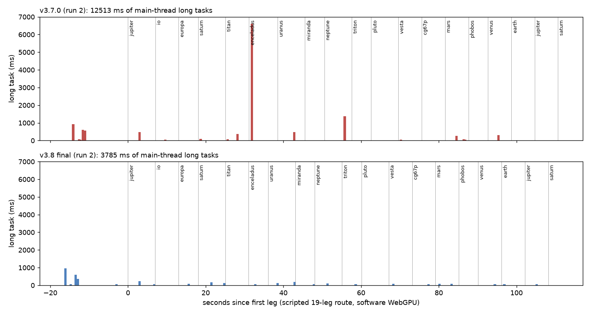

# 1. Scope and honesty statement

**What was measured.** This machine has **no GPU**. Every measurement uses Chromium 154 with SwiftShader WebGPU on 2 CPU
cores, where a single frame takes hundreds to thousands of milliseconds. So:

* frame rate, frame pacing and GPU time **cannot** be measured meaningfully here, and are **UNVERIFIED** for real hardware;
* what **can** be measured is the main-thread work that causes travel stutter on any machine: synchronous view construction,
  LUT builds, shader and material creation, mesh generation, decoding and pre-smoothing.

The same unmodified instrumentation was used on v3.7.0 and on v3.8.

**The test.** Scenario `tools/qa/scenarios/travel38.mjs` flies a scripted 19-leg route through first-visit destinations:
Jupiter, Io, Europa, Saturn, Titan, Enceladus, Uranus, Miranda, Neptune, Triton, Pluto, Vesta, 67P, Mars, Phobos, Venus, Earth,
and then Jupiter and Saturn again. It records:

* `longtask` entries (tasks over 50 ms on the main thread);
* `engine.getView` time per body (view construction, including atmosphere LUTs and materials);
* render-call CPU time per frame.

There were three runs per build. Run 1 of v3.7.0 was cold (first build of shader caches).

# 2. Root causes found

| ID | Stall | Measured (v3.7.0) | Root cause | Fix (version) |
|---|---|---|---|---|
| PERF-008 | Saturn first view | 6.3–12.2 s single task | ring-colour smoothing (`smoothRingColour`: canvas read-back + CPU box filter of the art map) on the main thread at first view | pre-smoothed 1024-sample asset, `tools/ingest/ring_colour_smooth.py` (v3.7.1/v3.8) |
| PERF-005 | Atmosphere LUT build per atmosphere | 240–400 ms per atmosphere body view (v3.7.0 run 2: Jupiter 403, Neptune 400, Uranus 380, Titan 344, Triton 339, Venus 285, Mars 244 ms) | transmittance/scattering LUTs integrated synchronously | Web Worker with binary16 transfer (v3.8); DEF-38-001 precision fix |
| PERF-009 | Family-shape mesh generation | 170–230 ms per irregular body view (Proteus 230, sat805 186, sat807 168 ms) | displaced icosphere built on the main thread | Web Worker (v3.8) |
| PERF-007 | First-frame shader/pipeline compile at arrival | long tasks of 0.1–1.4 s at arrivals not attributable to getView | materials created and first drawn in the arrival frame | predictive view preparation during the flight's last 40 % + pipeline warm frames (v3.8) |

# 3. Results (three runs each, same route, same machine)

| Run | Long tasks | Total (ms) | > 250 ms | Max (ms) | getView total (ms) | getView max (ms) | Worst body | Render CPU median (ms) | Render CPU p95 (ms) |
|---|---|---|---|---|---|---|---|---|---|
| v3.7.0 run 1 (cold) | 18 | 18,095 | 9 | 12,507 | 14,841 | 12,175 | saturn | 24.5 | 798 |
| v3.7.0 run 2 | 18 | 12,513 | 10 | 6,608 | 9,629 | 6,554 | saturn | 16.8 | 1,364 |
| v3.7.0 run 3 | 18 | 12,731 | 10 | 6,384 | 9,525 | 6,320 | saturn | 17.3 | 1,241 |
| v3.8 final run 1 | 20 | 3,913 | 6 | 956 | 565 | 144 | jupiter | 28.7 | 251 |
| v3.8 final run 2 | 23 | 3,785 | 3 | 960 | 535 | 117 | jupiter | 32.6 | 173 |
| v3.8 final run 3 | 21 | 3,869 | 6 | 1,006 | 569 | 140 | miranda | 24.4 | 230 |

**Summary, warm runs.**

* **Main-thread long tasks:** 12.5–12.7 s → 3.8–3.9 s, about **3.3× less**.
* **The worst single task in flight:** 6.4–6.6 s → under 1 s. The remaining ~1 s tasks happen at **start-up** (data parsing and
  the first scene), not during travel. The largest in-flight task is now about 250 ms.
* **View construction:** about 9.6 s → about 0.55 s in total, with the worst view now 117–144 ms.
* **Render CPU median:** slightly higher (24–33 ms against 17–25 ms). That is the predictive preparation and the extra
  per-frame work (frame coverage, overlap-weighted plume metering, enhancement rebuild). Under SwiftShader these numbers include
  software-adapter submission costs, so they are not representative of a GPU.

# 4. Loading

**What the loader shows.** The staged loader reports what actually happens:

* WebGPU validation, with the adapter and the time it took;
* the essential data, as a file count (13 files);
* the primary scene;
* renderer and shader preparation;
* "interactive", after which optional layers stream in.

**Measured in the loader stills.** WebGPU validation took 860 ms on SwiftShader. Interactive state was reached between the
2.5 s and 4.5 s stills (page load to interactive, software adapter).

# 5. Residency and streaming

* **Textures.** Residency is managed by `core/textures.ts`. High-resolution maps load only for D3+ detail tiers and discs
  over 320 px. This is unchanged from v3.5 and was not re-measured.
* **Stars.** The catalogue is not loaded before 300 AU. In the journey run, 36–54 shards were resident just after leaving the
  planets and 85 near Proxima. Each shard is SHA-256-verified.
* **Terrain.** Patches are SSE-refined. The remaining terrain patch builds take about 6 ms each on the main thread and were
  not a measured travel stall.

# 6. Not done / unverified

* **Real-GPU measurements.** No frame time, GPU time, VRAM or thermal behaviour was measured, so they remain UNVERIFIED. The
  protocol for the owner's RTX 3050 laptop is `docs/qa/RTX3050-guide.md` with `docs/qa/benchmark-protocol.md`. The same
  travel38 scenario can be run there with `npm run qa:smoke -- --script travel38` (without `--software`).
* **KTX2/Basis texture compression** (PERF-002) is not implemented; it needs a target-GPU format test.
* **Small-body compute pass.** It could not run under SwiftShader (GPU-003), so its cost is unmeasured.
* **Terrain patch generation** has not been moved to a worker.

# 7. Recommendations for v3.9

1. Run travel38 and the benchmark protocol on hardware, and set budgets: GPU frame time p95 under 16.7 ms at 1440p on an RTX
   3050-class GPU, and no main-thread task over 50 ms in flight.
2. Move terrain patch builds and the remaining material set-up into workers or idle callbacks.
3. Use KTX2 for the 160 MB of colour textures, behind a capability check.
4. Move Gaia bulk tiles to HEALPix with magnitude LOD, so the 100-pc layer does not dominate residency beyond 100 pc.
