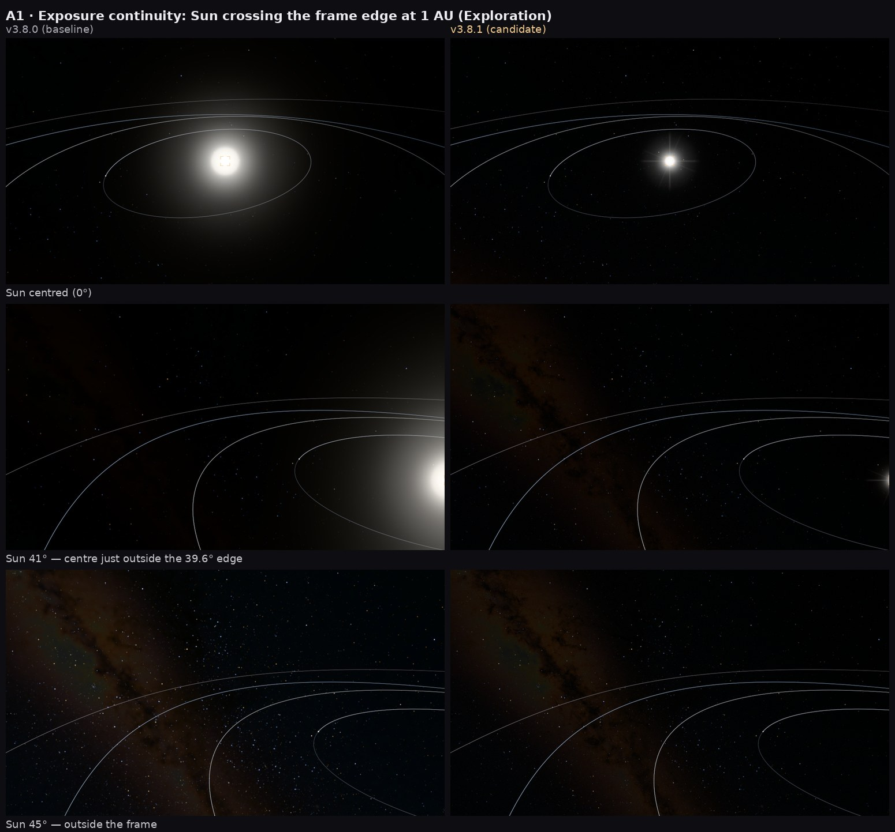
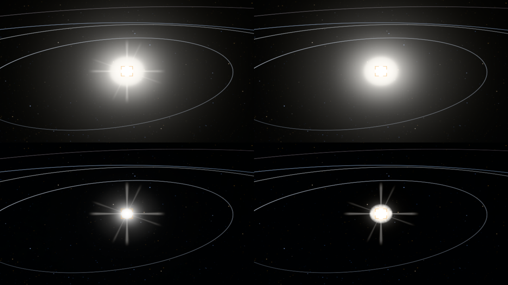
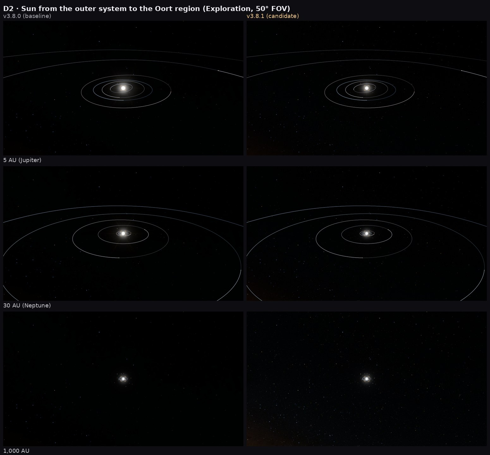
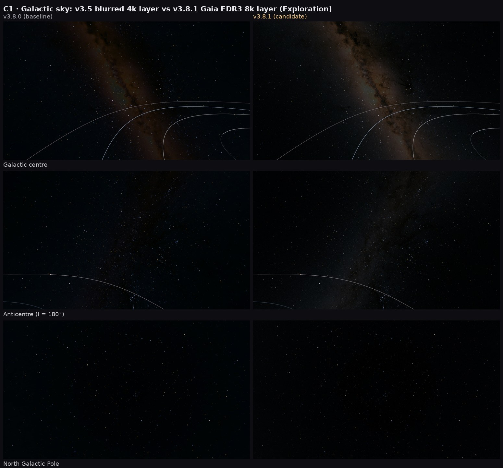

# 1. Status at a glance

| Gate | State | Evidence |
|---|---|---|
| 0 Baseline recovery | **Done** — 310/310 tests, typecheck, SW boot reproduced | WORKLOG §Gate 0 |
| 1 Diagnostics / root causes | **Done** for stars, exposure, Sun, sky; hardware stutter = hypotheses only | CPU trace, isolation captures |
| 2 Image formation + stars + Sun | **Implemented**, SW-verified, owner/hardware look pending | 13 new tests, A/B sheets |
| 3 Galactic sky | **Implemented** (new EDR3 layer); context-card work not started | A/B sheets |
| 4–7 | Not started (moons, atmospheres, rings, UI/intro, perf integration, release) | — |

Tests: **323/323 pass** (310 inherited + 13 new). Typecheck clean. Asset manifest 1,516 files, 0 unmatched.
Commits: `v3.8.0-supplied` (baseline) → current `HEAD` (see §7).

**Important limitation.** This sandbox has no physical GPU. Every capture here is Chromium 154 + SwiftShader software
WebGPU (≈ 0.1 frame/s): it proves the shaders compile and the composition is right, not the final look on your RTX 3050,
and not performance. A one-click benchmark kit is ready for your laptop (§6).

# 2. Confirmed root causes (proved, not assumed)

**STAR-J01 — star jitter near a selected star (the most serious owner defect).** The 3-D star layer computed
`star − camera` on the GPU with the camera as a single float32 vector. Near another star |camera| ≈ 1.3 pc, where one
float32 step is 0.0245 AU (3.7 million km): every frame the drawn star snapped by up to that amount while the camera,
in double precision, aimed smoothly at the true position. A deterministic trace of the real catalogue rows
(`tools/qa/star-stability.ts`) measured:

| Scenario (1920×1080, 50° FOV) | v3.8.0 jitter (RMS px) | v3.8.0 max error | v3.8.1 jitter | v3.8.1 max error |
|---|---|---|---|---|
| Proxima, zoom 50 → 0.05 AU | **38.9** | 105 px | 0.00006 | 0.06 px |
| Sirius, zoom 50 → 0.05 AU | **70.1** | 435 px | 0.00006 | 0.02 px |
| Proxima, hold at 5 AU (sim running) | 1.03 | 3.4 px | 0.001 | 0.001 px |
| Proxima, orbit drag at 20 AU | 0.51 | 0.46 px | 0.00005 | 0.0002 px |

Fix: camera split into float32 hi + lo parts and the subtraction reordered `((star − hi) + motion) − lo`, exact for nearby
stars by the Sterbenz lemma. The catalogue itself and its 64-bit body positions are untouched.

**EXP-381-01 — sky goes black when the Sun enters the view.** The sky's exposure was re-coupled to the scene camera by
`veil = 0.45 × [Sun centre inside ±1.1 NDC]` — a binary step on the frame edge, the same at 1 AU and 1,000 AU. Reproduced:
sky EV 21.1 with the Sun 45° off-axis, 18.2 at 41° (Sun's centre just outside the 39.6° edge) — the Milky Way vanished.
Fix: a continuous veil from the Sun's angular distance to the frame (12° margin) and its apparent magnitude, applied as a
bounded EV reduction (Exploration ≤ 2 EV, Cinematic ≤ 1.6 EV). Daylit air still re-couples physically; Scientific is
unchanged (physical camera). New sweep: 19.1 → 19.7 → 21.1 EV, smooth.

**SKY-381-04 — muddy Milky Way.** The runtime layer was Gaia DR2 at 4096×2048 passed through a 5×5 median + box blur
(≈ 20–25′ effective resolution) to remove stars — which also erased the dust-lane structure. Plus an anticentre mip seam
(SKY-381-02) and a dither that re-noised the whole sky every frame (SKY-381-03).

**SUN-381-01…05 — white blob Sun at Earth/Mars distance.** Isolated by switching layers off one at a time: the blob was
mostly the corona billboard (an art-directed "aureole" at 5 % of disc radiance, plus the physical Baumbach corona, both
10²–10³ × display white out to 3–5 solar radii when nothing else meters the exposure), then the old fixed-size glare quad
(always 45 % of frame height, constant fog term), and a disc clipped by 10⁴–10⁶ because disc metering only starts at
40 px radius. The default disc tint (1, 0.74, 0.46) also made it an orange lamp.

# 3. What changed

| Module | Change | Why |
|---|---|---|
| `galaxy/stars3d.ts`, `galaxy/starPrecision.ts` | hi/lo camera uniforms, reordered GPU subtraction; CPU twin for tests | STAR-J01 |
| `render/points.ts` | PSF σ in **device** pixels (0.62), exact per-pixel erf integral, normalised Moffat θ⁻³ wing, wing display compression for extreme sources | stable, energy-conserving, crisp stars; no 60-px white discs |
| `render/presentation.ts`, `engine.ts` | `sunGlareVeil` + `skyExposureV381`, new `sunVeilEV` mode parameter | EXP-381-01 |
| `render/sky.ts`, `main.ts`, `tools/ingest/sky_v381.py` | explicit-LOD sampling, static dither, streamed EDR3 8k log-luminance (r8) + 2k chroma, luminance-dependent saturation | SKY-381-02…06 |
| `render/sun.ts`, `engine.ts` | angle-space glare; local HDR disc presentation (3→12 px); neutral white balance + gentle labelled grade; aureole and uneclipsed-corona display caps (eclipse metering untouched) | SUN-381-01…05 |
| `qa/bench.ts`, `tools/bench/*` | in-app benchmark `?bench=1`, Windows one-click launcher | PERF-381-01 |

New sky asset: ESA/Gaia/DPAC "The colour of the sky from Gaia's EDR3 – equirectangular" (16000×8000, CC BY-SA 3.0 IGO,
ack. A. Moitinho), verified to share SOL's projection (cross-correlation 0.995, no shift). Only the 99,049 catalogue stars
SOL draws individually (V ≤ 9.5) are removed, at their catalogue positions (1.3 % of the map's flux, 2.1 % of pixels);
nothing is blurred. Provenance, SHA-256 and licence are in the asset manifest.

# 4. Evidence (software WebGPU captures, A = v3.8.0, B = v3.8.1, identical camera/epoch/FOV)

# 5. Honest limitations right now

- Not yet verified on real hardware: star crispness at your display scale, glare look, sky brightness, frame time.
- The Exploration Milky Way gain (×1.4) and Sun presentation constants are first-pass values chosen on software captures;
  they are labelled presentation parameters and will be re-tuned once your hardware screenshots or benchmark arrive.
- Not started yet: resolved stellar discs when approaching another star (WP-B close range), Galactic context card,
  moons/PDS shapes, atmospheres, rings, intro/UI, terrain regression, performance integration.
- The 3 non-commercial Uranian-moon textures are unchanged (rights decision needed from you later; WP-N).
- The supplied archive had no `.git`, so the reported v3.8.0 commit `a0cfcc6` can't be verified; a new repository starts
  from the supplied tree (`v3.8.0-supplied`).

# 6. Hardware benchmark kit (for your laptop)

`tools/bench/RUN-SOL-BENCHMARK-WINDOWS.bat` installs/builds on first run, starts a local server and opens Chrome at
`?bench=1`. About 3 minutes, hands-off: idle, cold travel (7 legs), warm repeat, Earth → Proxima → Earth, Sun pan at 1 AU,
Proxima zoom. It downloads `sol-benchmark-<date>.json` with frame-interval p50/p95/p99, hitch counts, CPU and (when the
adapter supports timestamp queries) GPU time, long tasks, heap, adapter and driver. The report labels itself HARDWARE vs
SOFTWARE so the two evidence classes can't be confused.

# 7. Next (continuing without waiting)

1. Gate 2 finish: Scientific/Cinematic captures, Sun FOV 20° and 3,000 AU ladder, star-visibility metric across modes,
   resolved-star approach design (angular-size-driven disc + limb darkening by spectral class, labelled).
2. Gate 3 finish: Galactic context card legibility + "Model" provenance labels; 0.3 pc and Proxima-neighbourhood sky views.
3. Gate 4: PDS shape models for Pan/Atlas/Prometheus/Pandora/Janus/Epimetheus/Helene/Telesto/Calypso/Hyperion; Venus,
   Mars, Titan, giant-planet limbs; Saturn ring structure.
4. Gate 5: intro/loader ("Into the Universe") and UI pass. Gate 6–7: perf integration, six reports, release ZIP.
