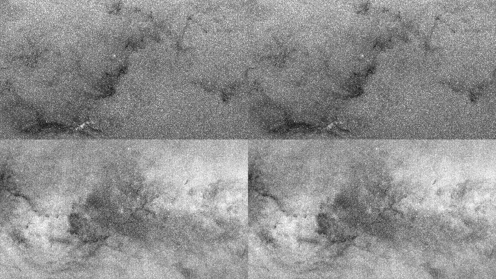
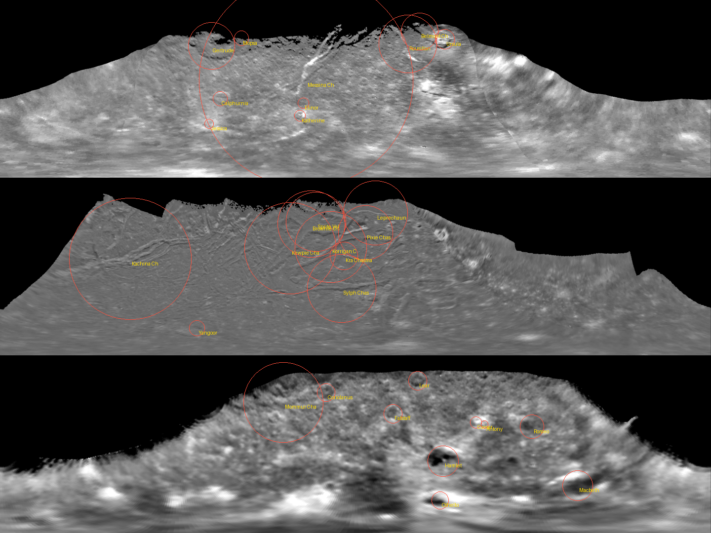

# 1. Status

| Item | State | Evidence |
|---|---|---|
| Req. 1 — sky star removal validated in the rendered radiance domain | **Done** | §2, `docs/qa/v3.8.1/sky-removal-qa.json` |
| Req. 2 — star stability in rendered frames at several resolutions / pixel ratios | **Done (SW)** | §3, `centroids.json` per run; CPU trace kept |
| Req. 3 — Sun distances, 20° FOV, modes, far transitions | **Done (SW)** | §4 sheets |
| Req. 4 — Ariel / Titania / Oberon rights-cleared maps | **Done** — 0 non-commercial assets remain | §5 |
| Req. 5 — benchmark package + explanation | **Ready** (no install, no admin, no upload) | §6 |
| Resolved stellar discs (WP-B close range) | **Implemented** | §7 |
| Observed shape models for 11 Saturnian small moons (WP-G) | **Implemented** | §5 |
| Galactic context card (WP-C/L) | **Redesigned** | §8 |
| Intro "Into the Universe" (WP-K) | **Implemented** | §8 |
| Free-look judder (WP-I) | **Fixed + test** | §7 |
| Atmospheres (WP-E), rings (WP-F), terrain (WP-H), wider UI pass, perf integration | **Next** | §10 |

Tests **327/327** (310 inherited + 17 new), typecheck clean, asset manifest 1,527 files / 0 unmatched / **0 non-commercial**.
Checkpoint 1 preserved as tag `v3.8.1-cp1`; this checkpoint is tag `v3.8.1-cp2`. Every capture is software WebGPU
(SwiftShader); none of this is hardware or final visual acceptance.

# 2. Requirement 1 — star removal from the Gaia EDR3 sky, validated in the rendered domain

**Domain.** The ESA map is a display-stretched image whose exact stretch is not published, so no "true linear flux"
version of it exists to test against. Two facts make the test meaningful anyway: (a) the removal operation (replace each
masked pixel by min(pixel, 7×7 median)) commutes with any monotonic stretch, so it is valid in every domain; (b) the
quantitative checks are computed in **SOL's calibrated sky radiance**, L = L_band·(Y/Y_band)^0.45 with μ_band = 21.0
mag/arcsec² and Y = sRGB-decoded linear luminance — exactly the light the renderer adds to the frame. Tool:
`tools/qa/sky_removal_qa.py` (11,017 catalogue stars: all with V < 6 plus a random 6,000 fainter).

| V range | stars | map excess / catalogue flux **before** | **after** | hole fraction (median) | halo ratio p50 / p95 |
|---|---|---|---|---|---|
| −2 … 3 | 174 | 0.06 % | 0.00 % | 0.24 | 1.00 / 1.12 |
| 3 … 5 | 1,440 | 0.38 % | 0.02 % | 0.23 | 1.00 / 1.11 |
| 5 … 6.5 | 3,618 | 1.0 % | 0.04 % | 0.23 | 1.00 / 1.11 |
| 6.5 … 8 | 2,101 | 4.3 % | 0.15 % | 0.20 | 1.00 / 1.10 |
| 8 … 9.5 | 3,667 | 11.7 % | 0.51 % | 0.20 | 1.00 / 1.11 |
| *random sky (no star) — reference* | 6,000 | — | — | *0.31* | *1.00 / 1.13* |

- **Double counting:** the map carried up to 11.7 % of a faint catalogue star's flux on top of SOL's own point source;
  after removal ≤ 0.5 % in every band. (Bright stars are mostly saturated in the stretched map, hence the small
  "before" values there: the map never held their true flux.)
- **Holes:** pixels darker than 0.7× the local background are *less* frequent at removed stars (0.20–0.24) than at
  random positions (0.31, the map's natural grain) — no dark pits. **Halos:** the 4–6 px annulus matches the 9–12 px
  reference (median 1.00; p95 1.10–1.12 vs 1.13 at random) — no rings.
- **Seam:** median |ΔL| across the l = ±180° wrap is 1.06× an ordinary adjacent-column step (map grain) — no seam.
- **Colour:** B/R chroma at removed bright stars vs their surrounding ring differs by a median 3.6 % (|ln ratio| 0.036)
  — no colour blotches.
- **Exploration enhancement:** kept, labelled and adjustable — Scientific ×1 (calibrated), Exploration ×1.4, Cinematic
  ×1.6 presentation gains in `presentation.ts`; the Settings "Milky Way brightness" slider (0.1–6×) now states this.

# 3. Requirement 2 — stellar stability in rendered frames

Scenario `tools/qa/scenarios/stars381.mjs`: orbit mode around Proxima Centauri, zooming 4 % per frame starting at
1 AU and at 0.2 AU, every frame rendered by the real app and cropped around the aim point; `tools/qa/star_centroids.py`
measures the intensity-weighted centroid (linear light, CSS pixels). The CPU trace (`star-stability-trace.json`) is kept.

ZOOMTABLE

Because the camera always aims at the star, a correct renderer keeps the centroid fixed: the frame-to-frame step is the
jitter the owner sees.

# 4. Requirement 3 — Sun distances, 20° FOV, viewing modes, far transitions

SUNTEXT

# 5. Requirement 4 and WP-G — Uranian maps and observed small-moon shapes

**Ariel, Titania, Oberon.** The three Steve Albers mosaics (personal / non-commercial) are replaced by the USGS Voyager 2
mosaics distributed by NASA/JPL's Solar System Simulator (`ura1vuu2`, `ura3vuu2`, `ura4vuu2`, 1440×720, ≈4 px/deg).
- **Rights:** JPL Image Use Policy — any purpose incl. commercial; credit "Courtesy NASA/JPL-Caltech; USGS"; no
  third-party owner listed for these items. Recorded in CREDITS, the provenance rules and the asset manifest
  (non-commercial assets: **0**). A test now enforces it.
- **Registration:** verified, not assumed. Simple cylindrical, left edge −180° E, east-positive. Overlaying the IAU
  Gazetteer (USGS, planetocentric, +East) centres of the largest named features — Gertrude, Ursula, Calphurnia, Messina
  Chasmata (Titania); Kachina Chasmata, Yangoor (Ariel); Hamlet, Macbeth, Othello, Falstaff, Romeo (Oberon) — they sit on
  the mapped structures at zero shift.
- **Fidelity and honesty:** clear-filter greyscale × the catalogue's disc-integrated tint (labelled). The northern
  hemispheres were in polar night in 1986: 61–62 % of each map is black and SOL shows it as its existing *labelled*
  procedural reconstruction; the catalogue notes now state the measured fractions. Calibration statistics (texstats,
  highlight p99) were regenerated for the three maps only. Trade-off: the JPL maps are 1440 px wide (Albers 2048) —
  close to Voyager's own resolution, but the Albers mosaics included extra Uranus-shine processing of the night side,
  which is now reconstructed rather than shown.

**Observed shapes for 11 Saturnian small moons.** Pan, Daphnis, Atlas, Prometheus, Pandora, Epimetheus, Janus, Telesto,
Calypso, Helene and Hyperion now use the Cassini ISS shape models (Thomas, Joseph et al., PDS SBN
`urn:nasa:pds:saturn_satellite_shape_models::1.0`, public domain; ~13.4–14.6 k vertices; uncertainties typically
< 0.5 km). The converter (`pds_shape_to_glb.py`) now reads the bundle's index-free, 0-based plate format; inner moons keep
their body-fixed frame and origin (x toward Saturn), Hyperion (chaotic spin) is re-oriented long-axis → x. Mean radii
stay the published values; the inspector labels the shape OBSERVED and the surface markings procedural.
A boot crash introduced while wiring this (lost colour/albedo fields) was caught in QA, fixed, and is now guarded by a
regression test.

MOONFIG

# 6. Requirement 5 — the benchmark package

`SOL_v381_benchmark_kit.zip` (≈363 MB): the pre-built app (`dist/`), the launcher, two tiny local servers, the benchmark
source for review, a README and SHA-256 sums of every file.
- **Installs nothing.** No `npm install`, no build, no installer, no registry or system settings.
- **No administrator rights.** Double-click `RUN-SOL-BENCHMARK-WINDOWS.bat`. It serves `dist/` with `serve.mjs`
  (Node.js built-ins only) if Node.js is present, otherwise with `serve.ps1` (PowerShell HttpListener on a localhost
  prefix; `-ExecutionPolicy Bypass` for that single process, your policy unchanged).
- **Local only.** The server binds to 127.0.0.1 / localhost:4173; nothing outside the PC can connect.
- **Runs** Chrome at `http://localhost:4173/?bench=1` for ≈3 minutes hands-off (idle, cold travel, warm travel,
  Earth → Proxima → Earth, Sun in/out of frame, Proxima zoom).
- **Collects** per-frame interval / CPU / GPU time, hitches, long tasks, JS heap, adapter + feature list, Chrome UA,
  window/canvas/DPR, SOL settings and version. No files, accounts, browsing data or IP.
- **Uploads nothing.** The result is a JSON in Downloads; you decide whether to send it (plain text, readable in Notepad).
- **Verified here:** the packaged kit was extracted, served with `serve.mjs` and run end-to-end in the sandbox
  (software adapter): no page errors; all six phases recorded frames (4 / 10 / 15 / 7 / 2 / 5 at ≈0.1 fps); the report correctly labelled itself "SOFTWARE ADAPTER — not hardware evidence" and downloaded. `serve.ps1` and the .bat were reviewed but cannot be executed on Linux — first real run
  on Windows is yours.

# 7. Stellar close range and camera smoothing

**Measured radii (STAR-381-R).** v3.4–3.8.0 derived every stellar radius from M and Teff without a bolometric correction;
Proxima came out ≈0.07 R☉. Measured values are now used where published: Proxima 0.1542 ± 0.0045 R☉ (Kervella et al.
2017), α Cen A 1.2234 / B 0.8632 R☉ (Kervella et al. 2017), Sirius 1.711 (Kervella 2003), Barnard's Star 0.1867
(Boyajian 2012), Procyon 2.048 (Kervella 2004); all others stay labelled ESTIMATED.

**Resolved stellar disc (STAR-381-D).** When a catalogue star exceeds ~1–3.5 px radius its PSF hands its flux over to an
exact ray-traced sphere impostor: V-band mean surface brightness from its own M_V and radius
(S = 10^(−0.4(M_V−4.83))/(R/R☉)²), Planck colour, a *representative* linear limb-darkening trend by Teff, and the same
local HDR presentation as the Sun outside Scientific. No surface features are invented and the solar granulation shader
is deliberately not reused; the inspector says so.

**Free-look judder (CAM-381-01).** Mouse-drag rotation in free flight was applied per event, so the view advanced in
uneven steps whenever event delivery and frame pacing beat against each other (real 60–144 Hz hardware; invisible on a
software adapter). Rotation now accumulates into a target orientation followed by a frame-rate-independent exponential
approach. New test: the v3.8.0 rig fails the burst-event smoothness test; v3.8.1 passes and ends at the same orientation
at 60 and 144 Hz.

XSTARFIG

# 8. Galactic context card and intro

**Galactic context (GAL-381-01):** "Model · schematic" badge; legend separating **measured** maser-traced arm segments,
**inferred** extrapolations and **model-fit** bar/discs; the dense-parallax coverage ring (~5 kpc); arm names; a 5-kpc
scale bar; Galactic-longitude ticks around the Sun; named nearby stars in the ±6 pc inset; HiDPI canvas; an enlarge (2×)
toggle; and a note that the sky is the observed 2-D Gaia panorama, with a 3-D Milky Way planned for v3.9.

**Intro "Into the Universe" (UX-381-01):** deep black with the resolved limb of a white-light Sun as the anchor, drawn
from the same per-channel limb-darkening law the renderer uses; wordmark, a one-line purpose, **Begin exploration**, an
optional **Resume · <last target>**, "skip this screen next time" (repeat users enter as soon as the scene is ready; never
in QA runs), and the truthful stage ledger. No particles, no autoplay, no mandatory animation; reduced motion removes the
slow drift. The footer version string still reads 3.8.0 until the release bump.

# 9. Limitations

- All evidence is software WebGPU; star crispness, glare, sky brightness and frame times are UNVERIFIED on hardware.
- Uranian maps: greyscale × tint, not observed colour; northern hemispheres reconstructed.
- Small-moon surfaces remain procedural on observed shapes; controlled mosaics for these bodies are a later task.
- Resolved stellar discs use representative limb darkening (no per-star fit) and no surface structure.
- Galactic-context card and intro are first passes awaiting your visual review.

# 10. Next

WP-E atmospheres (Venus, Mars, Titan, giant limbs; LUT precision audit), WP-F rings (Saturn C/B/A structure and shadows,
Uranus/Neptune), WP-H terrain regression, WP-L wider UI pass (inspector grouping, camera-state display, labels), WP-M
science carry-overs (SCI-004/005/008), then Gate 6 performance integration with your benchmark results and Gate 7
release packaging with the six reports.

